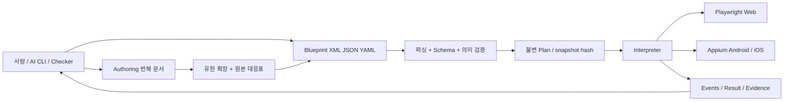
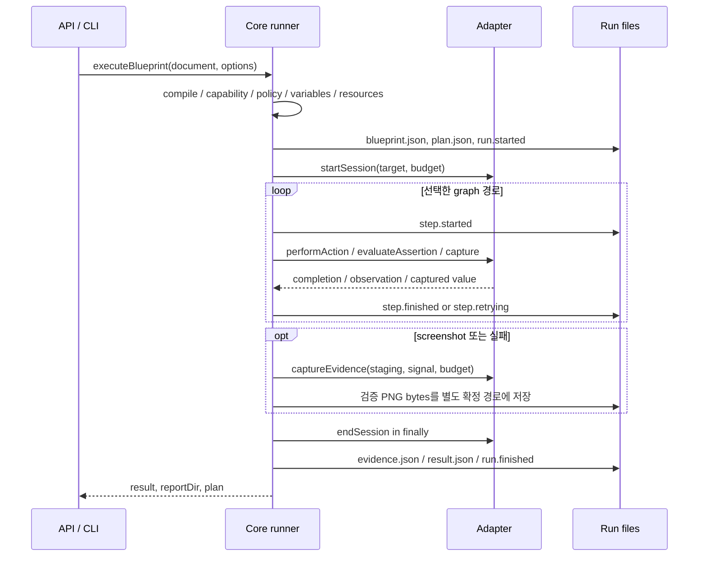
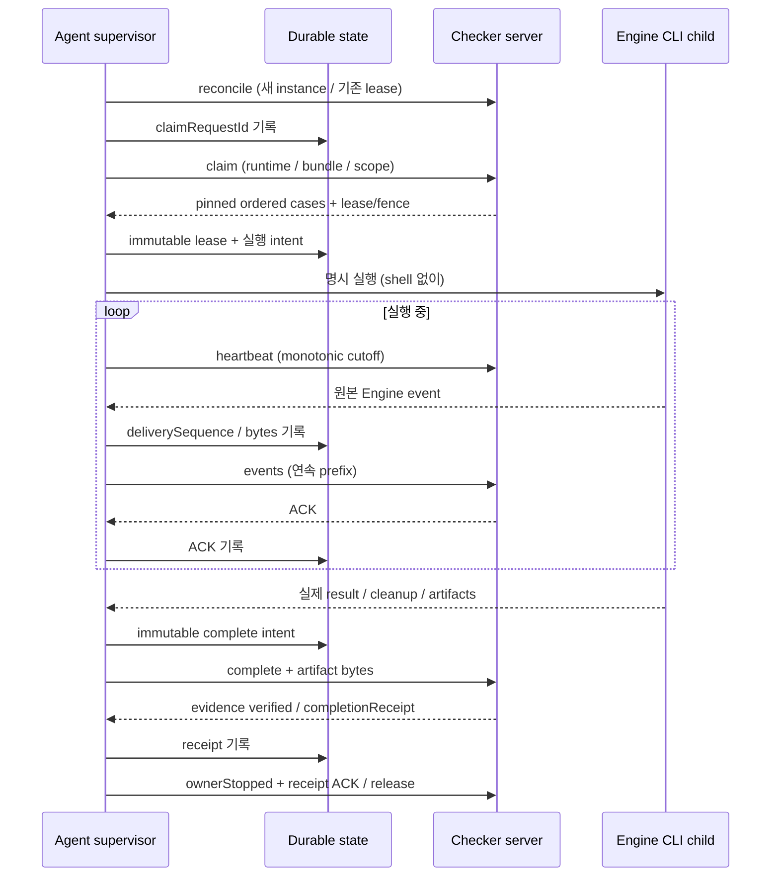

# Engine 구조와 실행 원리 리뷰

2026-11-07, runtime **0.1.0-alpha.8**, bundle contract **0.3.0-draft.2**의 소스/후보 기준 리뷰다. alpha.6 실제 서버 교차 인수와14절의 alpha.7 서비스 경계 인수는 역사 근거로 보존한다. 현재 모듈 구조는 [책임·의존 문서](modular-refactor.md), 최신 인수 상태는 [alpha.8 검증 기록](../validation-alpha.8.md)으로 구분한다. Git 기준점은 main `ecdb8ff87b1b45b93a38921a44d36c8adb068cd8`이고 이후 구현은 미커밋 상태다. 원격 npm 게시를 하지 않은 로컬 tgz preview이며 아래 설명은 실제 코드와 테스트가 보여 주는 동작이다.

## 1. 패키지 목적과 두 저장소 경계

Engine은 사람이 작성하거나 AI CLI/블록 편집기가 생성한 선언형 QA 문서를 검증하고 실제 대상에 적용하는 독립 Node ESM 패키지다. XML은 자체 Blueprint 교환 형식이지 Appium 명령어 문법이나 임의 프로그램이 아니다. Engine이 Claude/Codex를 호출하거나 사용자 JavaScript/shell을 실행하는 구조는 아니다.

| 담당 | 책임 |
| --- | --- |
| Engine | 정본 schema, parser/compiler/interpreter, adapter, CLI/API, event/result/evidence |
| Checker 사용자 웹 | 공용 테스트 시나리오 작성·배포, 실행 진행 조회 |
| Checker Flutter Desktop | 개별 블록/Flow/XML 작성·검증·실제 로컬 실행 요청 |
| Checker 서버 | 사용자·권한·Registry·업무 상태·배정. Engine 로컬 패키지의 필수 의존성이 아님 |

서버 업무 상태와 테스트 outcome은 다르다. Engine 설치 인수가 Checker 전체 UI/서버 인수까지 증명하지 않는다. 하나의 npm 패키지에서 core, `/playwright`, `/appium`의 공개 진입점을 제공한다. 다른 프로젝트는 source 경로를 가져오지 않고 package name으로 import한다. import 자체는 browser/session/child process를 시작하지 않는다.



## 2. 파일 구조와 역할

아래는 공개 기능의 진입점 중심 지도다. alpha.8의 내부 재배치와 각 상태의 소유권은 [모듈별 책임·의존 설계](modular-refactor.md)를 따른다. 기존 compiler/runner/documents/authoring/resources, Agent supervisor/materialize/reporting/store 경로는 facade 또는 조립 진입점으로 남고 실제 책임은 하위 모듈로 분리했다. 공개 의미와 source path에서의 내부 import를 새 소비 계약으로 혼동하지 않는다.

```text
contracts/
  schemas/qa.schema.json       입력·출력 정본 JSON Schema
  manifest.json               runtime/contract 식별
  releases/                   버전별 고정 bundle과 XML fixture
  release.json/xml-release.json 현재 공개 artifact hash
packages/core/
  index.mjs/index.d.ts         공개 API와 수동 API 타입
  schema-types.d.ts           schema에서 생성한 교환 타입
  documents.mjs/schema.mjs     입력 정규화와 Ajv 검증
  compiler.mjs                DAG·참조·정책·변수 검증, 불변 plan/hash
  authoring.mjs               bounded repeat 확장과 sourceMap
  runner.mjs                  실행 순서·예산·취소·사건·결과·증거
  resources.mjs               bounded read, containment, PNG/profile 자원
  observations.mjs            check report와 이미지 artifact 저장
  images.mjs/image-worker.mjs  제한된 별도 worker PNG 비교
  presets.mjs/xml.mjs          versioned UX 작성 template와 XML 직렬화
  errors.mjs                  공개 오류 코드와 CLI exit code
packages/cli/
  aqa.mjs                    명령 dispatch/프로세스 진입점
  args.mjs/commands.mjs        인자·help·문서·preset·진단 명령
  execution.mjs               실행·suite·adapter 조립
  control.mjs/output.mjs       stdin cancel·JSONL transport·durable replay
runners/playwright/
  adapter.mjs                 browser/context/page, locator와 action
  observations.mjs            픽셀·수치·viewport·가림·focus 관측
  capture.mjs                 민감 DOM 거부와 bounded 공개 값 수집
runners/appium/
  adapter.mjs/transport.mjs    W3C/Appium session·native action·bounded HTTP
scripts/                     bundle/type 생성, drift, 독립 tgz 설치 검증
tests/                       실제 Chromium, protocol, lifecycle, CLI/API
openspec/changes/             기능별 요구·설계·실제 인수 작업
```

읽는 순서는 [공개 API](../../packages/core/index.mjs) → [compiler](../../packages/core/compiler.mjs) → [runner](../../packages/core/runner.mjs) → [Playwright](../../runners/playwright/adapter.mjs)다. [CLI](../../packages/cli/aqa.mjs)는 같은 core를 조립하며 별도 실행 언어를 갖지 않는다. [공개 API](../package-api.md), [XML](../xml-format.md), [authoring](../authoring.md), [디자인 검사](../design-checks.md), [Appium](../appium.md)에 세부 교환 규칙이 있다.

## 3. 문서에서 불변 계획까지

### 파싱과 파일 경계

[documents](../../packages/core/documents.mjs)는 JSON/YAML/XML을 객체로 정규화한다. Blueprint는 Flow/Selectors/Target과 선택 TestCase/references를 묶는다. 단독 Flow/TC에는 selector/target manifest가 필요하고 TC.flowRef는 TC 디렉터리 기준이다. Suite는 cases를 순차 로드한다.

입력 문자열은 UTF-8 1MiB, 깊이는 128 미만이다. 파일은 regular file을 확인하고 max+1 byte만 읽는다. optional documentRoot/CLI --document-root는 최초 파일과 TC/Suite/selector/target 참조의 realpath containment를 적용한다. 미지정 시 기존 상대 참조를 유지한다. referenceRoot는 디자인 자산용 별도 경계다. realpath 확인과 실제 open 사이 파일 교체를 방지하는 OS sandbox는 아니다.

YAML 중복 key/과도한 alias와 예약 key를 거부한다. XML은 태그·속성 whitelist와 중복 singleton 검사를 하고 DTD/entity 선언을 허용하지 않는다. params·variables·selectors·target 등의 복합 값은 JSON CDATA로 교환하며 XML child를 JSON으로 숨겨 실행하지 않는다. `]]>` 분할과 속성 whitespace를 보존한다. 파싱 성공만으로 실제 graph가 유효한 것은 아니다.

### Schema와 의미 검증

[schema](../../packages/core/schema.mjs)는 schemaVersion/자료형/enum/필수값을 Ajv로 검사한다. [compiler](../../packages/core/compiler.mjs)는 다음 의미를 추가한다.

| 검사 | 실제 판정 |
| --- | --- |
| 플랫폼/capability | web/android/ios 및 해당 platform action whitelist. TV 거부. execute 때 주입 adapter 광고와 재대조 |
| graph | ID 유일, dangling/중복 edge 거부, 도달성, cycle 없음, nodes 1000/edges 2000 |
| 연결 | start 하나와 entry=start, action/assertion/start outgoing 하나, branch true/false 각 하나, end outgoing 없음 |
| selector/target | 별칭 존재, platform locator, web HTTP(S) exact origins/credential 거부, native 앱 package/bundle 식별 |
| reference/profile | ID 유일, 측정 selector 참조, target/reference profile 동일 hash, region/pixel 예산 |
| 변수 | literal/secret/capture 선언, valueRef/expectedRef/branch 참조, 모든 도달 경로 definite assignment |
| retry | 부작용 action 재시도는 allowSideEffects=true 필요 |

production 실행 opt-in과 secret 실값 존재는 execute preflight에서 확인한다. compile은 브라우저를 실행하지 않고 JavaScript나 기계어를 생성하지 않는다. 입력을 clone/freeze한 실행 계획을 만든다.

### Plan과 실행 identity

`qa.plan/v1`은 blueprint/entryNode/nodeOrder/requiredActions/secretRefs와 flowSnapshotHash/blueprintSnapshotHash를 갖는다. 객체 key를 재귀 정렬한 canonical JSON의 SHA-256이며 배열 순서는 유지한다. XML byte hash와 다른 의미다. sourceMap/UI metadata 변경도 정의 hash에 영향을 줄 수 있다. 실행에서 resolve한 비밀값/캡처값은 snapshot에 넣지 않는다.

nodeOrder는 계획 검토용이다. 실제 interpreter는 entry에서 outgoing edge를 따라 선택된 경로만 실행한다. executeBlueprint는 외부 plan을 그대로 신뢰하지 않고 Blueprint를 다시 compile한다. run의 attempt=1은 step.retry 횟수와 다르다.

## 4. 반복, 변수, action

Authoring의 `qa.authoring/v1`은 고정 count 1..100, 순서 있는 action/assertion steps를 선언한다. [authoring module](../../packages/core/authoring.mjs)은 repeatID/회차/stepID를 해시한 고유 node ID로 DAG를 펼친다. 입력/확장 각각 1MiB, 결과 1000 nodes/2000 edges다. body branch·중첩 repeat·동적 while은 지원하지 않는다. 원본 bytes와 불변 sourceMap은 별도 보관하고 result/event의 snapshot/nodeId는 확장 Blueprint 기준이다.

branch는 literal 또는 선행 capture 변수의 equals/notEquals 비교다. secret branch는 거부한다. 합류점의 모든 predecessor에 capture가 있어야 읽을 수 있고 재캡처 전 이전 값을 삭제한다. `public:true`는 사용자의 신뢰 선언이며 PII 자동 탐지 보장이 아니다. password/OTP/data-qa-sensitive의 자신·조상·검사된 하위 DOM 및 secret 변수 혼합을 거부한다. 16,384자/10,000 DOM 방문/128 ancestor 예산을 browser 내부에서 검사한 뒤 값만 전달한다. capture 실패의 자동 PNG도 생략한다.

| action | 플랫폼/의미 |
| --- | --- |
| launch | web URL goto 또는 native 앱 activate |
| tap | web locator.click / native element click |
| input / clear | fill / native clear+value. 실제 OS IME 입력 검사가 아님 |
| waitFor | visible/hidden 조건 |
| assertVisible / assertText / assertValue | 요소 상태 또는 문자열 일치. assertValue는 expected/expectedRef 중 하나 |
| screenshot | required 정책에 따른 PNG 수집. 그 자체는 이미지 비교 아님 |
| assertImage / assertLayout | web profile 기반 PNG 비교 / 명시 수치 측정 |
| assertInViewport / assertHitTarget / assertFocused / assertUrl | web 조작 전 위치·대표점 가림·focus·URL 관측 |
| browserBack | web history 이동. HTTP 응답 또는 SPA popstate 확인 |
| captureText / captureValue | web 공개 DOM text/입력값 → 선언된 runtime 변수 |
| mobileBack / hideKeyboard | Appium native back/키보드 요청. 브라우저 history와 구분 |

web locator는 testId/text(exact)/role/css, native는 accessibilityId/id/xpath다. DOM 존재와 실제 locator 유일성은 runtime에서 판정한다. captureText는 보이는 text node의 순서 연결이며 innerText 공백 규칙과 동일하지 않다.

retry는 0..3회 재시도, 최초 포함 최대 4회다. ASSERTION_FAILED/ELEMENT_NOT_FOUND만 재시도하고 같은 step/run deadline을 공유한다. branch에서 선택하지 않은 노드는 unvisited이며 실패가 아니다. 실패 후 후속 반복/노드도 unvisited다. Suite는 순차 실행이고 취소 후 다음 case를 시작하지 않는다.

## 5. Adapter 호출과 lifecycle



기본 run timeout은 60초(최대 300초), 기본 node timeout은 10초다. run/step 예산과 AbortSignal로 adapter Promise를 제한한다. session cleanup은 별도 5초, 실패 증거는 별도 3초이므로 원 run deadline을 넘겨 유한 정리가 이어질 수 있다. 자산 preflight는 run timer 시작 전이지만 파일·개수·byte/PNG 픽셀 제한이 있다.

event는 JSONL에 append한 다음 onEvent에 순차 전달한다. callback 자체 reject는 sanitized ENGINE_ERROR/infra_error이고 내부 run deadline 소진은 TIMEOUT/run → failed다. 이후 callback을 끄지만 durable 결과/정리는 계속한다. 이미 실패한 step.finished에서 최초 callback이 실패하면 원 실패를 보존하고 cleanupErrors로 전달 오류를 기록한다. terminal callback은 result 저장 후 별도 1초 제한이며 실패하면 API가 reject하되 저장된 판정은 바뀌지 않는다.

취소는 cancelled result/terminal과 미방문 노드로 표시한다. CLI --control-stdin은 UTF-8 JSONL `{ "type": "cancel" }`을 AbortController로 연결한다. 빈 EOF는 취소가 아니다. line 4096 bytes/총 65536 bytes 제한을 두며 unknown/malformed 입력은 진단한다. CLI는 observer 중단 뒤 durable JSONL의 schema/identity를 검사하고 이미 출력한 sequence 이후만 보충한다. suite는 runId별 sequence를 구분한다. stdout EPIPE는 재전송 루프 없이 전달 실패로 끝난다.

신뢰하지 않는 custom adapter/callback을 프로세스 격리하는 기능은 없다. 동기 무한 점유에는 JS timer가 작동할 수 없고 unresolved Promise/이미 시작한 외부 부작용을 강제 중단하지 못한다. 내장 browser는 finally에서 닫고 Appium은 알려진 session ID 삭제를 시도한다. 서버가 응답하지 않아 생성 ID를 모르는 native session은 서버 command timeout/운영 확인이 필요하다.

## 6. 디자인·UX 검사 원리와 범위

이미지 diff, CSS 수치 측정, 동작 확인은 별도 verdict다. Engine은 Figma API를 직접 호출하지 않고 PNG+명시 기준수치/mapping을 받는다. referenceRoot 안의 realpath/hash를 확인하고 PNG IHDR/CRC/압축 형식과 픽셀 예산을 먼저 검사한다. pngjs 7.0.0 worker는 timeout/cancel 시 terminate한다. PNG 하나 10MiB, 전체 자원 64MiB/128개, 이미지 16,777,216 pixels 제한이며 지원하지 않는 interlace/color profile/APNG는 비교불가다.

profile은 실제 browser version/OS/viewport/DPR/locale와 대조한다. CSSpx region은 DPR로 PNGpx 경계에 환산한다. baseline 크기 불일치/profile 불확실은 blocked, 허용오차 초과는 failed, 수집장애는 infra_error다. 결과 PNG baseline/actual/diff와 schema 검증된 check-report를 보관한다. 측정은 bbox x/y/width/height, 요소간 signed gap, 허용 CSS font-size 등 whitelist다. 기대 수치에는 source 문서/hash가 있다.

폰트는 선언된 asset hash와 실제 page 응답/loaded font 정보를 확인한다. `injectFonts:true`를 명시해야 시험환경에 주입하며 report에 표시한다. 기본 모드에서 누락 폰트를 자동 주입하여 앱 로딩 문제를 숨기지 않는다. font response 크기/개수/확인 가능성에 제한이 있다.

기본 web-input preset은 조작 전에 viewport/대표 hit point를 관찰한 다음 tap→focus→input→value 확인을 한다. click/fill의 auto-scroll/focus가 결함을 숨기기 전에 검사한다. web-history-back은 기대 URL/화면을 지정한다. SPA 같은 URL state 이동도 popstate로 관찰하며 mobile system back과 혼용하지 않는다. 검사 coverage는 사용자 mapping이 지정한 요소/화면에 한정된다. iframe/canvas/shadow DOM 및 대표점 밖의 모든 가림을 보장하지 않는다.

## 7. 허용 대상, 비밀값, 증거 정책

web origin allowlist는 Playwright route를 통한 요청 제한이다. OS 전체 network sandbox가 아니며 custom adapter의 임의 네트워크를 차단하지 않는다. production은 명시 allowProduction/--allow-production을 요구한다. native endpoint/udid/automationName은 Blueprint XML이 아니라 API 또는 --appium-config의 로컬 실행 설정이다. 기본 loopback만 허용하고 remote는 명시 opt-in HTTPS다.

secret은 from:secret의 secretRef를 env/secretResolver/ignored secrets-file로 해석한다. 파일은 1MiB regular file, JSON object, 256개 이하 문자열 값만 허용하고 parse 원문을 진단에 노출하지 않는다. secret 변수가 있는 run은 screenshot/이미지 비교를 생략 또는 blocked 처리한다. 직접 literal/target/metadata에 비밀을 넣으면 snapshot에 그대로 저장될 수 있다. custom QaError.message는 신뢰 입력이므로 모든 임의 메시지 자동 비식별화를 보장하지 않는다.

screenshot은 기본 best-effort이나 성공으로 위장하지 않는다. 수집 불가/오류는 step.skipped이며 전체 다른 검사가 통과하면 run.passed일 수 있다. required:true에서 보호 정책 skip은 blocked, 수집 장애는 infra_error다. 실패 후 보조 evidence 오류는 최초 실패를 덮어쓰지 않는다.

alpha.5는 각 capture에 고유 staging 경로를 예약하고 signal/deadline을 재검사한다. PNG bytes를 검증한 후 별도 확정 파일에 exclusive write하고 manifest에 추가한다. returned result/events는 내부 배열과 분리한 frozen snapshot이다. 늦은 custom adapter 쓰기는 staging 파일을 남길 수 있지만 확정 artifact hash/result를 변경하지 못한다. 이것은 custom 코드가 임의 경로를 직접 건드리지 않는다는 adapter 신뢰 경계 내 보장이다.

## 8. Artifact, 오류 transport와 exit code

각 run은 `<report>/<runId>/`에 blueprint.json/plan.json/events.jsonl/result.json/evidence.json 및 PNG/check-report를 쓴다. result는 임시 파일을 rename하여 확정한다. 각 artifact에는 type/path/contentType/sha256/size가 있다. JSONL identity는 `(runId, attempt, sequence)`이며 terminal.resultPath는 run 디렉터리 기준 result.json이다. 소비자는 schema·상대 경로·hash를 검증해야 한다.

| CLI exit | 의미 |
| --- | --- |
| 0 | passed 또는 비실행 명령 성공 |
| 1 | 테스트 failed |
| 2 | 잘못된 문서/인자 등 실행 전 오류 |
| 3 | infra_error/전달·실행 장애 |
| 4 | blocked/미지원/정책 거부 |
| 5 | cancelled |

CLI run --json stdout에는 event와 기본 error JSON이 함께 나올 수 있다. 기계 소비자는 --diagnostics stderr를 지정해 오류 진단을 분리한다. API는 실행전 오류에 reject, 실행 중 판정에 result 반환, terminal 전달/파일 I/O 실패에 reject할 수 있다. 강제 kill/디스크 오류에 terminal 존재를 보장하지 않는다.

## 9. 실제 사용 예

```powershell
npm install ./automated-qa-engine-0.1.0-alpha.8.tgz --ignore-scripts
npx --no-install playwright install chromium
npx --no-install aqa --help
npx --no-install aqa template --format xml --out test.xml
npx --no-install aqa validate test.xml
npx --no-install aqa run test.xml --json --diagnostics stderr --report artifacts
```

template은 예제 localhost:4317을 대상으로 한다. 소스 저장소에서는 별도 터미널에 `node examples/server.mjs`를 실행하거나 서버까지 관리하는 `npm run demo`를 쓴다. 사용자 대상 URL/selector로 바꾼 XML에는 해당 대상 환경이 필요하다. 작동하는 완전한 XML은 [정본 fixture](../../contracts/releases/qa-blueprint-0.1.0-alpha.8.xml), 반복 XML은 [authoring 예제](../authoring.md)를 참고한다.

```javascript
import {loadBlueprint,compileBlueprint,executeBlueprint} from 'automated-qa-engine';
import {PlaywrightAdapter} from 'automated-qa-engine/playwright';
const blueprint = await loadBlueprint('test.xml', {documentRoot: process.cwd()});
const plan = compileBlueprint(blueprint);
const controller = new AbortController();
const output = await executeBlueprint(blueprint, {
  adapter: new PlaywrightAdapter(), signal: controller.signal,
  reportDir: 'artifacts', onEvent: event => console.log(event.type),
});
console.log(plan.blueprintSnapshotHash, output.result.outcome);
```

API 타입은 공개 .d.ts와 schema 생성 타입을 제공하며 NodeNext ES2022 소비를 검증한다. 타입은 runtime graph/size/policy 검사를 대체하지 않는다. 설치 후 사용은 [공개 API](../package-api.md), native 설정은 [Appium 문서](../appium.md)를 따른다. doctor/devices native 결과는 설정 유효성만 나타내며 targets=[]/connectionVerified:false를 유지한다. 연결된 실기기를 찾았다는 의미가 아니다.

## 10. 검증 근거와 버전 변화

`npm run verify`는 foundation/문서 링크/OpenSpec strict/bundle·타입 drift와 전체 tests를 검사한다. `npm run test:package`는 npm pack을 새 임시 소비 프로젝트에 설치하고 package-name import, 설치 CLI, 올바른/틀린 TypeScript 소비 및 실제 실행의 result/terminal/hash를 검증한다. sibling source import로 대체하지 않는다.

| 버전 | 실제 변경/근거 |
| --- | --- |
| alpha.2 | XML strict/export와 독립 패키지; 초기 39 tests. 실패 step observer 오류 시 result 누락 결함 후속 발견 |
| alpha.3 | observer failure 보존, CLI 분리/stdin cancel/JSONL replay; 외부 소비 7 runs |
| alpha.4 | 디자인·UX/preset, Appium protocol; 116 tests, 외부 소비 20 runs. native real device 미검증 |
| alpha.5 | bounded authoring/capture/documentRoot/secret input/evidence 정책; 128 tests, 외부 설치 26 runs. [고정 hash/인수](../validation-alpha.5.md) |
| alpha.6 | optional Agent CLI/정책/lease/outbox/reconcile. 전체158 tests와 추가 native 불확증 회귀, 외부26 runs, 실제 Checker의 순차 Suite·취소·응답 유실·재시작/복구·PNG 자산·게시 Suite 예약 PASS. 최종 package hash는 [인수 기록](../validation-alpha.6.md) 참조 |

alpha.4 검증 세부와 고정 hash는 [기록](../validation-alpha.4.md)에 있다. alpha.4 tgz는 보존한다. alpha.5에서는 tests/authoring.test.mjs의 1000/1001 경계와 실제 반복 Chromium, tests/capture.test.mjs의 합류/민감 DOM/취소/비노출, tests/input-evidence.test.mjs의 containment/secret map/required/late evidence 회귀를 추가했다.

### 재현 결함의 수정 이력

alpha.2에서 action ASSERTION_FAILED 이후 실패 step.finished callback이 처음 throw하면 endSession은 호출되지만 result/terminal이 없었다. alpha.3는 settlingFailure 분기를 두어 최초 failure를 보존하고 observer 진단만 cleanupErrors에 넣는다. 파일 I/O 예외는 숨기지 않는다. 이 설명은 역사 근거이며 현재 미수정 결함으로 해석하지 않는다.

alpha.4에서 timeout된 custom capture가 늦게 완료하면 artifacts.length 기반 같은 PNG 경로를 덮어쓰고 반환 result 배열도 증가할 수 있었다. 관리자가 30ms step/200ms 수집으로 재현했다. alpha.5는 고유 staging/확정 bytes/snapshot으로 수정했고 지연 완료 후 manifest hash와 반환/저장 result 동일성을 회귀로 확인한다. 기존 통과 테스트 수는 이러한 미포함 경계가 없다는 증거가 아니다.

## 11. 설계 장단점과 남은 제약

장점은 동일 schema/compile 경로가 AI·GUI·CLI 의미를 통일하고, hash/sourceMap이 원본·확장·실행을 연결하며, adapter와 공개 타입이 Checker 밖 재사용을 가능하게 한다는 점이다. 이미지·수치·동작 판정을 나누어 비교불가를 성공으로 숨기지 않는다. 반대로 엄격한 선언형 범위와 자원 한도는 임의 테스트 코드를 그대로 실행하는 도구보다 작성 가능 범위가 좁다.

| 제약 | 현재 범위 |
| --- | --- |
| browser/session | 한 Chromium page의 순차 흐름. 다중 창·동시 branch/병렬 Suite 미지원 |
| target/시스템 경계 | 한 Blueprint는 하나의 target/session. 여러 앱·서버 API·서로 다른 시스템 사이의 값을 묶어 비교하는 다중 target TC는 현재 미지원 |
| Suite 문서 | 로컬 qa.suite/v1 JSON/YAML의 파일 참조 순차 실행. raw Suite XML 루트/정규화 명령은 미지원. Agent는 서버가 고정한 ordered Blueprint cases를 소비 |
| 반복/변수 | 고정 유한 확장과 공개 DOM string. 동적 loop·nested repeat·secret capture 미지원 |
| 모바일 | Appium 코드/protocol 테스트 구현. Android/iOS 실기기·OS 키보드 실제 동작 미검증, TV 미지원 |
| 시각 기준 | 명시 PNG/profile/수치. 직접 Figma API, 모든 색공간·레이아웃·가림의 자동 판정 미지원 |
| 신뢰 경계 | custom adapter/callback은 같은 프로세스의 신뢰 코드. 동기 무한 점유 강제 종료 불가 |
| 취소/파일 | best-effort 외부 정리, late staging 잔여 가능. 디스크 장애/강제 kill에 terminal 보장 없음 |
| 비밀/개인정보 | from:secret과 알려진 민감 DOM 정책. literal 비밀값/모든 PII 자동 감지 보장 없음 |
| 서버 운영 | optional Agent의 실제 Checker 교차 인수 완료. 서버 권한·Registry·예약 정책과 UI 전체 인수는 Checker 소유 |

qa-design-ux-demo는 alpha.4 구현·인수를 마친 기능이며 이전 리뷰의 미구현 초안 표시는 역사 상태다. 실제 기기 검증은 완료 범위에 포함하지 않는다. alpha.6 Agent transport는 기존 서버 없는 package API/CLI 실행과 분리되어 있다.

## 12. 재현 및 작업 추적

```powershell
npm run verify
npm run test:package
git diff --check
```

뒤 설치 검증 명령은 새 tgz와 인수 artifact를 만든다. 기존 고정 버전 artifact를 덮어쓰는 용도로 실행하지 않는다. 문서 갱신은 기존 reusable-package 문서 task와 alpha.5의 qa-bounded-authoring/qa-captured-variables/qa-input-evidence-policy 인수에 연결한다. Appium real-device 미완료 task는 실제 환경 확보 전 완료로 표시하지 않는다.

## 13. Optional Agent의 실행·전송 분리

Agent는 core API의 필수 부분이 아니다. [CLI dispatch](../../packages/cli/aqa.mjs)는 `aqa agent`를 명시한 경우에만 supervisor를 dynamic import한다. 이 명령이 서버에서 승인된 업무를 받고, 실제 동작은 별도 child의 기존 `aqa run --json --control-stdin`으로 수행한다. Desktop 없이 독립 프로세스로 동작하며 일반 import/로컬 run에는 Agent credential이나 서버가 필요하지 않다.

| 모듈 | 역할과 경계 |
| --- | --- |
| [config](../../packages/agent/config.mjs) | bounded 로컬 설정, 기본 빈 project/resource/credential allowlist |
| [protocol](../../packages/agent/protocol.mjs) | Checker 정본 OpenAPI bytes SHA와 요청·응답 schema 검증. 실행 DSL은 기존 Engine schema 유지 |
| [transport](../../packages/agent/transport.mjs) | HTTPS/명시 loopback HTTP, redirect 거부, 요청 timeout/응답 byte 제한, 고정 오류 메시지 |
| [store](../../packages/agent/store.mjs) | 단일 writer gate/lock, hash-chain journal, fsync, durable intent/outbox/ACK |
| [materialize](../../packages/agent/materialize.mjs) | scope 교집합, snapshot/자산 hash, private 파일, native 초기 app/activity 검증 사본 |
| [lease](../../packages/agent/lease.mjs) | 요청 시작 monotonic 기준 TTL cutoff와 AbortSignal |
| [child](../../packages/agent/child.mjs) | 설치 CLI direct spawn, event identity 검증, stdin 취소/강제 종료, 실제 result/artifact 대조 |
| [reporting](../../packages/agent/reporting.mjs) | 원본 event envelope 전송, durable sentHighWater 이하 ACK, 전체 artifact receipt 집합 검증 |
| [supervisor](../../packages/agent/supervisor.mjs) | startup reconcile→claim intent→순차 case→보고→receipt→instance release |



서버 lease의 executionId/jobAttempt/fence와 Engine runId/attempt/sequence는 다르다. Agent의 deliverySequence가 여러 case를 한 전송 순서에 묶으며 원본 events를 다시 번호 매기거나 미실행 case의 결과를 합성하지 않는다. HTTP 성공/업로드 완료와 테스트 PASS도 분리된다.

재시작은 기존 실행을 다시 시작하는 동작이 아니다. 완료 receipt 유실이면 서버의 closed decision과 로컬 hash 증거를 대조해 전송 상태만 복구한다. 실행 intent 뒤 종료 불명 상태면 quarantine한다. 서버에만 있는 유실 claim도 조회에서 발견하며 `resume` directive를 조작 재개 허가로 사용하지 않는다. historical request는 immutable evidenceRequestId/body를 재사용하고 receipt를 기록하지만 정상 event ACK나 실행권으로 승격하지 않는다.

TTL 30초/heartbeat 5초/요청 5초/여유 5초이며 만료·fence 거부 시 active child를 취소한다. child 강제 종료나 native 세션 생성 응답 유실의 infra_error는 외부 session 정리를 확증하지 못하므로 unknown이다. 네트워크 전송 실패가 이미 확인된 cleanup을 unknown으로 덮어쓰지는 않는다. PID 부재 확인이 불가능하거나 재사용된 PID가 살아 있으면 이전 instance release를 자동 수행하지 않는다.

한 Agent의 active lease는 하나이며 cases는 순차 실행한다. journal 64MiB/20,000 records, record 4MiB, lease 7MiB, HTTP body 16MiB, artifact 파일 10MiB·실행 합계 64MiB 한도를 둔다. 큰 lease/결과는 별도 immutable bytes/hash reference로 journal에 연결한다. 자동 GC·OS 서비스 설치·프로세스 밖 native 강제정리 보장은 없다. 정확한 설정과 운영 복구 경계는 [Agent 문서](../agent.md)를 따른다.

candidate-2의 [store](../../packages/agent/store.mjs)는 확정 HTTP204 empty claim 128개마다 또는 한도 근처에서 해당 claim 기록만 checkpoint한다. single-writer queue 아래 임시 journal을 쓰고 fsync한 뒤 atomic replace하며 기존 event/ACK/receipt, unknown claim과 실행 intent는 보존한다. 이는 유휴 polling만으로 약 2시간 47분 뒤 기록 한도를 소진하던 candidate-1 결함의 수정이며 실행 이력의 일반 GC가 아니다. 교체 전후 crash 5경계와 낮은 기록 한도에서 반복 polling을 테스트했다.

첫 네트워크 요청 전에 instanceId/ownerPid를 기록한다. idle owner가 강제 종료되어 서버 소유권만 남으면 전체 reconcile과 이전 OS process 부재를 확인한 뒤 empty receipt release를 요청한다. 로컬 미확정 lease가 서버 응답에서 사라지거나 기존 PID가 살아 있으면 진행하지 않는다. state root를 새로 만들거나 삭제하는 것은 복구 방법이 아니다.

서버 운영자의 감사 기록을 가진 `recovered`도 실행 재개 권한이 아니다. [supervisor](../../packages/agent/supervisor.mjs)는 operatorRecovery의 ID/시각/기존 fence/증가한 fence와 이전 process 부재를 검증하고 local phase를 recovered로 바꾸되 원래 QA 결과와 cleanup unknown을 보존한다. 같은 owner에 정상 closed receipt가 남아 있으면 그 실제 receipt를 별도로 ACK한다. 서버의 독립 검증과 이전 owner retirement 후 새 instance/lease/execution identity로만 작업을 받는다. 상세 실서버 사례와 패키지 hash는 [alpha.6 인수 기록](../validation-alpha.6.md)에 구분한다.

## 14. alpha.7 서비스 경계 보완

Windows stdout pipe 미소비가 실행 event loop까지 막는 실제 반례를 [output](../../packages/cli/output.mjs)과 [writer child](../../packages/cli/output-child.mjs)로 격리했다. 부모는 QA 실행만 담당하고 stdout/stderr마다 지연 생성한 helper가 실제 stream을 쓴다(최대2개). 채널당 IPC 미확인1건, 메시지8MiB, ACK2초다. 정체 시 해당 helper를 종료하고 같은 channel을 다시 쓰지 않는다. 정상 소비자는 두 stream을 읽고 stdin cancel로 종료 기회를 줘야 한다. 강제 parent kill은 자손 종료를 보장하지 않는다. 가벼운 [metadata](../../packages/cli/metadata.mjs)/help는 실행 adapter를 로드하지 않는다.

내부 run deadline이 observer 대기 중 만료되면 TIMEOUT/run → failed다. callback 자체 reject/전달 실패는 ENGINE_ERROR/infra_error이고 외부 cancel과 이미 결정한 failure는 보존한다. node budget과 adapter mismatch가 경합하면 먼저 관측한 TIMEOUT/step 또는 ASSERTION_FAILED가 남으며 둘 다 failed다. terminal 이후 전달 실패는 디스크 outcome을 바꾸지 않는다. API의 동기 무한 callback/custom adapter를 같은 event loop에서 강제 중단할 수 있다는 보장은 없다.

Flow1000노드/2000edge에 맞춰 result visited/unvisited를1000으로 늘렸고 artifact256은 유지했다. [limits](../../packages/core/limits.mjs)의 수집 예약은 다중 PNG/report 전체 슬롯을 사전에 확인한다. 초과는 실행 중 실패로 기록하고 기존 artifact를 보존한다. cleanupErrors는256개로 집약하되 CLEANUP_ERROR가 남아야 한다. runner successor/visited는 Map/Set을 사용하지만 compiler는 실측1000노드 약103ms여서 검증 제거 없이 유지했다.

Web/Appium text/value는 동일 node 예산 안에서 비동기 값을 기다린다. Playwright 중복 시작을 거부하고 endSession은 진행 중 launch와 합류하여 실제 browser 종료를 확인한다. Appium POST 생성 요청 뒤 ID/DELETE 미확증은 cancelled라도 CLEANUP_ERROR다. Agent child는 cleanup unknown을 유지하고 supervisor는 해당 lease를 정상 release하지 않는다. HTTP fixture의 이 동작은 실제 기기 삭제 성공 증거가 아니다.

13절의 alpha.6 empty204 checkpoint는 역사적 수정이다. alpha.7 store는 latest set 키를 모두 남기고 내구 ACK payload를 queue-base/high-water로 압축하며 pending 순서를 유지한다. v1 읽기/v2 checkpoint이며 구 reader로 v2를 열면 거부한다. unknown/active/historical/receipt/tombstone과 immutable 파일은 삭제하지 않는다. entries/bytes 및 retained key/queue 용량을 내부 status로 관찰할 수 있지만 영구 tombstone은 유한 저장 한도에 도달할 수 있다. 운영자는 정상 정리와 서버 reconcile·보관 절차를 거쳐야 하며 state 삭제로 과거 실행을 반복하면 안 된다.

후보2 외부 소비에서 드러난 step.started 직후 전체 예산 만료도 후보3에서 보완했다. nodeDeadline이 run과 node 중 어느 예산에서 왔는지 추적하고 내부 timer/실제 budgetSignal 만료만 그 phase로 분류한다. 어댑터가 조기에 던진 임의 TIMEOUT은 전체 run timeout으로 바꾸지 않는다. 최신 전체178개, 외부 설치79파일 SHA/API/CLI/bin/타입 및 영향 성능 인수는 [alpha.7 검증 기록](../validation-alpha.7.md)을 따른다. 실제 Checker 서버·예약 통합은13절 alpha.6의 이력이며 이번 alpha.7은 별도 설치와 HTTP fixture 소비다. Checker 기본 pin·기존 서버/운영 Agent 승격이나 사용자 state migration을 수행하지 않았다.

## 15. alpha.8 전체 모듈 리팩터링

14절은 alpha.7 인수 이력이다. alpha.8은 그 동작을 기준으로 source223파일, runtime37개와 타입4개를 전수 분류하고 내부 의존·상태 소유를 재구성했다. 공개 core/adapter/CLI/schema 경로와 execution contract0.3.0-draft.2의 bytes는 유지한다. 새 모듈과 유지 모듈의 이유·검사 대응은 [모듈 책임 표](modular-refactor.md)에 있다.

compiler는 정본 버전·액션·hash 공급 역할을 domain으로 넘기고 순서가 명확한 validator를 조립한다. runner는 event sink, node interpreter, artifact owner와 report writer를 연결한다. 실행 node는 mutable artifact 배열·파일 디렉터리를 소유하지 않는다. CLI는 명령 catalog와 문서/작성/진단/실행 경로를 구분해 문서 명령에서 구체 adapter가 로드되지 않게 했다. Playwright session은 public browser/context/page 필드와 시작/종료 합류를 소유하고 Appium session은 native ID/정리 미확증을 소유한다.

Agent supervisor는 claim, 실행, reporting-only 복구와 release를 조립한다. recovery에서 실행 child로 가는 의존은 없다. state는 lock, codec, model, journal과 API facade로 나누되 v1/v2와 정확한 journal byte 순서를 비교했다. 이를 위해 운영 state를 삭제하거나 이동하지 않았다. 생성기는 순수 렌더를 파일 check/write와 분리했고 외부 설치 인수는 pack/install, 실제 소비, 파일 manifest 검증으로 나눴다.

의존 검사는 AST와 부정 fixture를 사용하며 단순 문자열 검색으로 import를 추정하지 않는다. process/worker edge는 ESM cycle과 다르고 computed resource는 정확한 승인 manifest만 허용한다. 이것은 임의 사용자 코드를 실행하는 sandbox 기능 추가가 아니다.

독립 동작21개는 alpha.7과 차이가 없었다. 문서 validate/plan 시간은 줄었지만 실제 browser wall과 parent RSS는 증가했으므로 전체 성능 개선을 주장하지 않는다. 증가 비용은 관리 검토에서 구조·호환 인수와 구분해 후속 성능 추적 항목으로 수용했다. 최종 회귀·패키지·Checker 격리 인수와 정확한 SHA는 [alpha.8 검증 기록](../validation-alpha.8.md)을 따른다.
