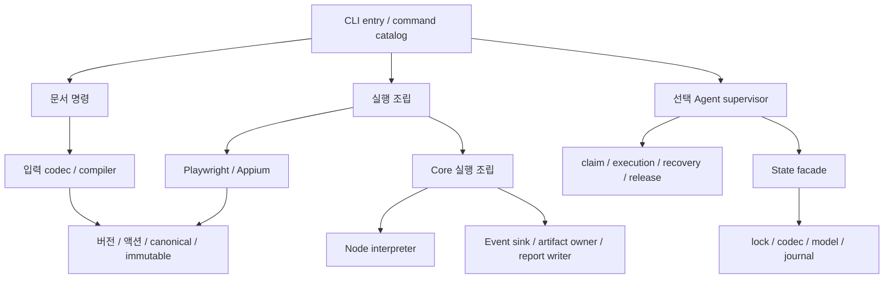

# alpha.8 모듈 책임과 호환성

2026-11-07. alpha.7의 실행 계약을 유지하면서 내부 책임과 의존 방향을 재구성한다. runtime은 alpha.8, execution contract는 0.3.0-draft.2이며 JSON Schema와 Agent HTTP pin bytes는 그대로다. 현재 검증 진행 상태는 [alpha.8 인수 기록](../validation-alpha.8.md)을 따른다. 별도 설치 후보가 기존 Checker 기본 pin이나 운영 Agent를 자동 교체하지 않는다.

## 공개 진입점과 의존 방향

`packages/core/index.mjs`, `packages/cli/aqa.mjs` 및 npm bin, `/playwright`, `/appium`, 각 공개 타입, schema와 버전별 bundle 경로는 유지한다. 내부 하위 모듈은 새로운 공개 API가 아니다.

core는 CLI·Agent·구체 adapter에 의존하지 않는다. adapter는 compiler·schema validator·runtime을 참조하지 않는다. domain은 무거운 실행·검증 모듈을 불러오지 않는다. CLI 문서 명령은 구체 adapter를 로드하지 않고 실행과 진단 명령만 필요할 때 adapter를 선택한다. Agent child→CLI는 별도 프로세스 경계이며 ESM 순환으로 계산하지 않는다.

`npm run check:architecture`는 TypeScript AST로 static/reexport/literal dynamic import와 worker/process/resource URL을 구별한다. 신규 runtime 파일도 자동 탐색하며 금지 의존을 facade 뒤까지 추적한다. 승인하지 않은 computed 경로, file URL/절대 경로, CommonJS loader와 미지원 runtime 확장자는 실패한다. public self-import는 실제 공개 진입점으로 해석한다. computed release/HTTP schema 경로 두 개는 정확한 파일·위치·표현식·대상 목록을 [예외 manifest](../../scripts/architecture/exceptions.json)에 기록하며, 사용하지 않는 예외도 실패한다. 이는 지원된 ESM 소스 구조를 검사하는 개발 게이트이지 임의 JavaScript를 격리하는 sandbox는 아니다.

## 책임별 상태 소유

| 책임 | 모듈 | 소유하는 상태 또는 정책 |
| --- | --- | --- |
| 기초 값 | core/domain | package manifest 버전, action 순서, canonical hash, freeze와 clone+freeze의 구분 |
| 입력 | core/codecs, core/documents | JSON/YAML/Blueprint XML의 해석과 별도 파일 참조 조립 |
| 작성 | core/authoring | direct API의 getter·hidden·symbol 보호, 유한 repeat 전개, source map, 별도 Authoring XML 정책 |
| 계획 | core/compiler, validation | 기존 schema→target→capture policy→references→nodes→graph→definite assignment 순서와 불변 plan |
| 파일·이미지 | core/io, media | bounded regular file 읽기·realpath 경계, PNG CRC/크기, 디자인 reference hash와 총량 |
| 실행 | core/runner, runtime/node | session→graph 진행→settlement→cleanup 순서, 변수 frame과 node 단일 retry 예산 |
| deadline | core/runtime/deadline | 내부 deadline provenance, 외부 취소 및 timeout의 구분 |
| event | core/runtime/events | sequence, durable append, observer 중단 및 terminal 전달 한도 |
| artifact | core/runtime/artifacts, evidence | 단일 mutable manifest, 고유 staging 이름, late append 차단, count/snapshot/capture/collectObservation 경계 |
| 결과 | core/runtime/report | blueprint/plan 초기 파일, evidence와 원자 result 저장 |
| CLI | cli/catalog, args, help, commands, execution | 인자 규격, 지연 dispatch, secret/config, adapter 선택, Suite, durable replay |
| 웹 | playwright/session, locator, actions, assertions | browser/context/page 및 startup/cleanup join, 요소 선택, 실제 행동과 polling 단언 |
| 모바일 | appium/configuration, session, elements, actions, assertions, png, transport | 명시 연결 설정, session ID와 cleanup 불확증, 요소 polling, native 동작, W3C 응답 한도 |
| Agent 실행 | agent/service | claim intent, lease 실행, reporting-only 복구, owner release; recovery는 executeChild를 호출하지 않음 |
| Agent 입력/전송 | agent/materialize, reporting | local/server 정책 교집합, immutable 자료, native config, event ACK, completion receipt, historical intent |
| Agent 상태 | agent/state | lock/nonce, record codec, pure reducer, serial journal/fsync/checkpoint; store는 기존 API 조립 |
| 생성/설치 인수 | scripts/generation, package | 순수 contract/type 렌더와 check/write, pack/install/실제 소비/파일 SHA 비교의 분리 |

실행 node에는 report 디렉터리나 mutable artifact 배열을 넘기지 않는다. artifact subsystem이 수집·저장을 소유하고 실행에는 좁은 메서드와 detached frozen snapshot만 제공한다. event sink는 디스크 오류와 observer 오류를 같은 catch로 합치지 않는다. run/node deadline·cancel 우선순위, primary failure 및 terminal 이후 immutable 결과는 alpha.7과 같다.

## 유지한 경계와 합치지 않은 정책

- `errors`, `schema`, `limits`, `images`와 image worker, presets, 브라우저 capture/observations는 이미 독립된 정책 또는 실행 realm을 가진다. 의존과 가독성을 검토하되 불필요한 추가 계층을 만들지 않는다.
- direct Authoring 입력 검사는 Blueprint 파서의 reserved-key 검사보다 강하다. 단일 약한 validator로 대체하지 않는다.
- canonical `sha256:` snapshot hash와 raw bytes SHA-256은 다르다. freeze-owned와 clone-then-freeze도 caller 소유권이 다르다.
- Appium screenshot의 W3C base64/구조 검증과 core PNG CRC/색상 정책은 같은 함수로 교체하지 않는다.
- Agent HTTP와 Appium HTTP의 인증·크기·오류·redirect·deadline 정책이 달라 공통 거대 transport를 도입하지 않는다.
- state의 최신 key, ACK cursor, pending, tombstone, crash hook와 v1/v2 byte 순서를 보존한다. 운영 state 이동·삭제·downgrade 작업은 하지 않는다.
- 예전 Dart spike와 ADR은 선택 근거로 유지한다. 게임 도메인이나 Checker UI를 Engine에 추가하지 않는다.

## 전수 범위와 인수

기준은 main/ecdb8ff의 dirty 소스를 별도 보존한223파일, alpha.7 패키지79파일이다. `artifacts/modular-refactor-20261107/baseline/manifest.json`은 정확한 SHA와 원본을 기록한다. `artifacts/modular-refactor/STRUCTURE-AUDIT.md`는 기존37runtime+4type를 한 파일씩 분류한다. 최종 source 대응은 `artifacts/modular-refactor-20261107/source-coverage.json`에 유지/수정/새 파일과 검증 분류를 남긴다. 파일 수 자체를 완료나 성능 개선 지표로 사용하지 않는다.

차등 인수는 alpha.7과 같은 입력을 사용한다. plan은 engineVersion만 정규화하며 snapshot hash·node 순서는 동일해야 한다. event/result는 명시한 run identity·시각·duration·version·임시 경로만 정규화한다. 사용자 필드, 실패 code/phase/message, branch·방문 순서, artifact bytes는 그대로 비교한다. 전체 회귀와 외부 package/bin/타입, 실제 Chromium, Appium protocol 및 Agent fixture를 별도로 검증한다. 실기기와 실제 운영 승격은 이 리팩터링의 완료 주장에 포함하지 않는다.
