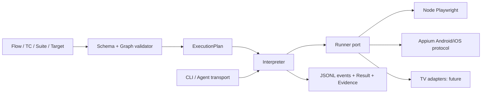

# 엔진 시스템 설계

현재 소스/후보: alpha.10 / execution contract 0.3.0-draft.2. 정확한 배포 상태는 [버전별 검증](../validation-alpha.10.md)을 따른다. 내부 모듈 구조는 alpha.8, 별도 재사용 작성 계약은 alpha.9에서 도입했다. alpha.10 실패 정리 이벤트의 독립1초 전달 예산은 실행 action의 run 예산을 연장하지 않는다.

## 책임 경계

alpha.8의 실제 모듈 대응과 의존 검사 규칙은 [모듈 책임 문서](modular-refactor.md)에 있다. compiler/runner facade는 기존 진입점을 유지하고 domain·validation·runtime 하위 책임을 조립한다. Agent는 state와 service, adapter는 session과 동작 계층을 구분한다.

Engine는 테스트 실행 규격, load/validate/compile/execute, selector/secret resolution, adapter, CLI, event/result/evidence를 소유한다.
Checker는 작성·게시·권한·사용자·예약·Agent 배정·결과 보관을 소유한다. 엔진은 Slack/Flutter/중앙 DB가 없어도 실행되어야 한다.

## 목표 배치와 현재 상태

| 경로 | 소유 | 현재 |
| --- | --- | --- |
| contracts/ | JSON Schema와 version/hash가 있는 public bundle/XML fixture | alpha.10 / 0.3.0-draft.2, authoring0.1.0-draft.1 local-preview |
| packages/core/ | validator, plan, interpreter, JSON/YAML/XML | Node ESM 공개 API/타입 구현 |
| packages/cli/ | aqa entry, JSON/JSONL transport, exit mapping | 실행 가능 |
| runners/playwright/ | browser/session lifecycle, action/assert/evidence | 실제 Chromium 검증 |
| runners/appium/ | 명시 endpoint/capabilities, native action/assert/evidence | HTTP protocol 검증; 실기기 미검증 |
| packages/agent/ | optional lease/child/outbox/reconcile | core와 분리; 서버 없는 로컬 실행 유지 |
| examples/ | credential 없는 local web / pass·fail Flow | 실행 가능 |
| tests/ | unit/contract/real browser acceptance | 실제 테스트 존재 |
| scripts/ | 환경 진단·P0 설정 검증 | 실행 가능 |

Dart/Node bridge를 실제 검토한 뒤 Node ESM core/CLI를 선택했다. [ADR](adr-001-runtime.md)을 따른다. Blueprint와 plan은 추가 교환 객체이며 AI CLI/GUI는 같은 노드 ID와 event를 사용한다.

## 실행 파이프라인

1. JSON/YAML/XML 파싱 → schemaVersion/필드/자료형 검증. 별도 authoring의 유한 반복은 고유 ID의 Blueprint DAG로 전개한다.
2. graph의 entry/중복 ID/dangling/unreachable/cycle/branch true·false/end를 검증. 실행 Flow는 최대1000노드/2000edge 유한 DAG다.
3. target·selector·variable·secretRef·capability 요구를 확인하고 immutable plan/snapshot을 만든다.
4. action allowlist와 대상 환경 정책 검증 후 session을 연다. 임의 shell/network 명령은 DSL에 없다.
5. 순서와 retry 예산을 interpreter가 관리한다. run deadline은 step retry가 초기화하지 않는다. 기본 retry=0; 부작용 action 재시도는 명시적 허용이 필요하다.
6. 시작/종료 events를 기록한다. assertion failure도 증거를 수집하며 증거 수집 실패가 원래 판정을 가리지 않게 한다.
7. timeout/cancel/runner crash를 포함해 finally에서 session/process를 정리하고 terminal result를 원자적으로 기록한다.

## Adapter와 확장

Runner port: getCapabilities, startSession, performAction, evaluateAssertion, captureEvidence, endSession.
각 adapter는 플랫폼별 지원 액션을 선언한다. webOS/Tizen/Android TV adapter는 미구현이다. 없는 기능은 UNSUPPORTED_CAPABILITY이고 통과로 보고하지 않는다.
Agent는 engine release를 실행하는 transport다. 중앙 scheduler/lease/권한 저장소를 엔진 core에 추가하지 않는다.

## 검증 설계

P1의 실제 PASS/FAIL, 잘못된 graph/selector/secret/unknown schema, timeout/cancel, child runner crash, 불완전 JSONL, 동시 실행 artifact 충돌을 검증한다.
실기기 없는 Appium/TV 검사는 hardware-unverified로 표시한다. contract fixture만 통과했다고 기기 실행 성공으로 보고하지 않는다.

## 서비스 프로세스 경계

CLI는 명령별 인자를 검사하고 version/help를 가볍게 로드한다. 실행 module은 실행 명령에서만 로드한다. Windows의 동기 stdout pipe를 작은 writer child에 격리하며 부모 실행은 채널별 IPC ACK 최대2초/메시지8MiB/미확인1건으로 제한한다. stdout/stderr별 helper는 지연 생성되어 최대2개다. 정상 소비자는 stdout/stderr를 동시에 drain하고 `--control-stdin` 취소 뒤 terminal/result를 확인해야 한다. 강제 parent kill은 자손 browser/writer 종료를 보장하지 않는다.

core callback 자체 reject는 ENGINE_ERROR, 내부 run deadline 소진은 TIMEOUT/run, 외부취소는 CANCELLED다. 결과 작성 뒤 전달 오류는 이미 확정된 outcome을 바꾸지 않는다. result 노드 목록은1000, 공개 artifact는256이며 수집 초과를 실행 중 실패로 기록한다. cleanup 진단 집약은 CLEANUP_ERROR를 보존한다. Appium 생성 요청 후 ID/DELETE가 미확증이면 Agent cleanup unknown과 quarantine을 유지한다.

Agent journal v2는 latest set과 ACK high-water, pending 전송, 실행 금지 tombstone을 보존하며 정상 이력의 중복 payload를 압축한다. v1을 읽지만 v2를 만든 뒤 구 Engine으로 같은 state를 열면 거부된다. immutable 증거 파일 자동 삭제와 무제한 수명은 제공하지 않는다. [운영 경계](../agent.md), [상세 구조 리뷰](engine-review.md)를 참고한다.

