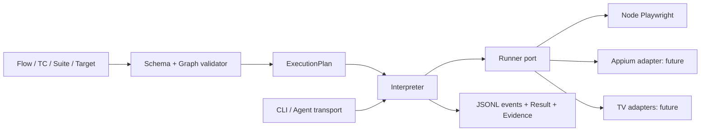

# 엔진 시스템 설계

## 책임 경계

Engine는 테스트 실행 규격, load/validate/compile/execute, selector/secret resolution, adapter, CLI, event/result/evidence를 소유한다.
Checker는 작성·게시·권한·사용자·예약·Agent 배정·결과 보관을 소유한다. 엔진은 Slack/Flutter/중앙 DB가 없어도 실행되어야 한다.

## 목표 배치와 현재 상태

| 경로 | 소유 | 현재 |
| --- | --- | --- |
| contracts/ | JSON Schema와 version/hash가 있는 public bundle/XML fixture | 0.1.0-alpha.2 local-preview |
| packages/core/ | validator, plan, interpreter, JSON/YAML/XML | Node ESM 공개 API/타입 구현 |
| packages/cli/ | aqa entry, JSON/JSONL transport, exit mapping | 실행 가능 |
| runners/playwright/ | browser/session lifecycle, action/assert/evidence | 실제 Chromium 검증 |
| examples/ | credential 없는 local web / pass·fail Flow | 실행 가능 |
| tests/ | unit/contract/real browser acceptance | 실제 테스트 존재 |
| scripts/ | 환경 진단·P0 설정 검증 | 실행 가능 |

Dart/Node bridge를 실제 검토한 뒤 Node ESM core/CLI를 선택했다. [ADR](adr-001-runtime.md)을 따른다. Blueprint와 plan은 추가 교환 객체이며 AI CLI/GUI는 같은 노드 ID와 event를 사용한다.

## 실행 파이프라인

1. JSON/YAML 파싱 → schemaVersion/필드/자료형 검증.
2. graph의 entry/중복 ID/dangling/unreachable/cycle/branch true·false/end를 검증. P1은 유한 DAG만 허용한다.
3. target·selector·variable·secretRef·capability 요구를 확인하고 immutable plan/snapshot을 만든다.
4. action allowlist와 대상 환경 정책 검증 후 session을 연다. 임의 shell/network 명령은 DSL에 없다.
5. 순서와 retry 예산을 interpreter가 관리한다. run deadline은 step retry가 초기화하지 않는다. 기본 retry=0; 부작용 action 재시도는 명시적 허용이 필요하다.
6. 시작/종료 events를 기록한다. assertion failure도 증거를 수집하며 증거 수집 실패가 원래 판정을 가리지 않게 한다.
7. timeout/cancel/runner crash를 포함해 finally에서 session/process를 정리하고 terminal result를 원자적으로 기록한다.

## Adapter와 확장

Runner port: getCapabilities, startSession, performAction, evaluateAssertion, captureEvidence, endSession.
각 adapter는 플랫폼별 지원 액션을 선언한다. webOS/Tizen/Android TV는 각각 별도 capability를 가진다. 없는 기능은 UNSUPPORTED_CAPABILITY이고 통과로 보고하지 않는다.
Agent는 engine release를 실행하는 transport다. 중앙 scheduler/lease/권한 저장소를 엔진 core에 추가하지 않는다.

## 검증 설계

P1의 실제 PASS/FAIL, 잘못된 graph/selector/secret/unknown schema, timeout/cancel, child runner crash, 불완전 JSONL, 동시 실행 artifact 충돌을 검증한다.
실기기 없는 Appium/TV 검사는 hardware-unverified로 표시한다. contract fixture만 통과했다고 기기 실행 성공으로 보고하지 않는다.

