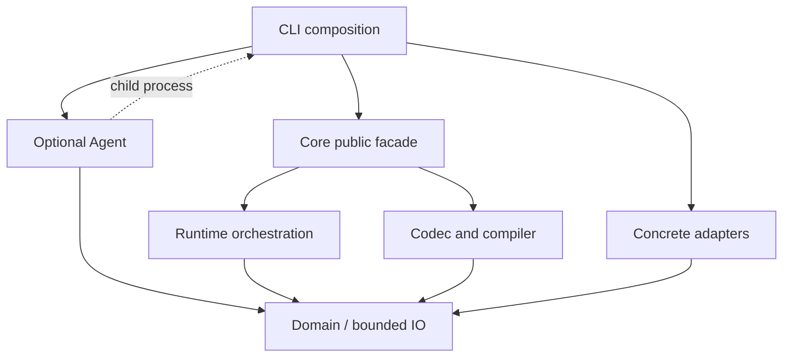

# Design

## Context

기준은 main/ecdb8ff의 alpha.7 dirty 소스다. `artifacts/modular-refactor-20261107/baseline/manifest.json`은223파일의 실제 bytes/hash, branch/HEAD/status와 공개79파일의 hash를 기록하고 source/ 및 tracked.diff를 보존한다. frozen tgz SHA는0199b719baaf2f41c46b6e6cb07dc8ddd80464923c639ed724cae612f31c80c3이다. 기준 검증은178tests와 외부 API/CLI/타입 및 Checker 격리 소비다. 새 작업 때문에 과거 완료/미완료 task를 다시 쓰지 않는다.

독립 감사의 초기37 runtime AST에서 compiler fan-in11, resources fan-in10이 확인됐다. compiler는 version/actions/hash 때문에 adapter와 Agent까지 schema 로딩에 연결하고, CLI commands는 validate/schema에도 Playwright를 정적 import한다. 정적 ESM 순환은 발견되지 않았으므로 기존 순환 결함을 수정한다고 주장하지 않는다. child→CLI→Agent는 별도 process edge이며 import cycle과 구분한다.

## Goals / Non-Goals

**Goals:** 책임별 상태 소유자, 하향 의존, 작은 명시 collaborator, 유지·변경 파일 전수 추적, 실제 소비 계약 동등성. 밀집한 다중 statement는 대상 책임을 분리하며 읽을 수 있도록 정리한다.

**Non-Goals:** action/프로토콜/정책 추가, public API 확대, schema 변경, journal v3, dependency 추가, 범용 DI/service locator, FSD 강제, 전면 TypeScript 전환, 실기기/운영 승격.

## Decisions

### 1. 공개 표면과 의미를 고정한다

`packages/cli/aqa.mjs`와 package bin 경로, core/index.mjs·index.d.ts, ./playwright·./appium exports와 adapter 클래스/생성자, contracts/schemas/qa.schema.json 및 contracts/releases/qa-contract-VERSION.json 경로를 유지한다. 기존 내부 경로를 쓰는 테스트/개발 도구는 얇은 재export facade로 호환시킬 수 있지만 실행 의미를 facade에 중복 구현하지 않는다. 별도 공개 plugin API는 만들지 않는다.

관리 승인대로 runtime alpha.8 / contract0.3.0-draft.2다. JSON Schema bytes·Agent HTTP schema/pin·preset version/hash·XML 의미는 같다. bundle의 runtimeVersion/hash만 새로운 버전에 맞게 생성한다. alpha.7 모든 frozen 파일을 덮어쓰지 않는다. Checker counterpart는 qa-engine-refactor-compatibility이며 검증된 후보 후 격리 소비만 한다.

### 2. 의존 방향과 경계 검사

core는 cli/agent/runners를 import하지 않는다. adapters는 compiler/runner/CLI/Agent를 import하지 않고 domain·검사 지원 모듈에만 의존한다. domain은 adapter/validator/runtime 의존이 없다. CLI는 실제 command를 lazy load하고 document 명령은 구체 adapter를 로드하지 않는다. Agent child process 진입은 명시 process edge로 허용한다. static import/export·literal dynamic import·new URL worker/child entry를 AST로 분리 수집해 missing file/금지 layer/ESM cycle을 검사한다. computed dynamic 경로는 명시 검토 항목으로 남기고 무조건 안전하다고 통과시키지 않는다. architecture 검사는 실제 package 파일 목록과 연결한다.

computed dynamic 경로는 승인된 manifest의 정확한 파일·위치·종류에 해당하지 않으면 gate를 실패시킨다. warning만 출력하며 통과하지 않는다. 새 파일은 자동으로 검사 목록에 들어가고 예외 manifest는 사용 근거와 가능한 경로를 명시해야 한다.

### 3. Core의 상태와 정책을 분리한다

- domain/version, actions, canonical, immutable는 가벼운 leaf다. version은 package.json 한 정본에서 읽고 기존 exports는 재export한다. prefixed canonical hash와 raw file SHA, freeze-only와 clone+freeze는 이름과 책임이 다른 helper이며 입력/출력 의미를 합치지 않는다.
- compiler는 schema→target/reference→node semantics→graph→definite assignment→plan의 기존 검사 순서를 유지하는 조립 함수다. validation/target, references, nodes, graph, variables에 판단을 분리한다. 각 함수는 필요한 document 부분과 검증한 graph 결과만 받는다. 전체 mutable context를 전달하지 않는다.
- documents는 파일 참조 조립이고 codecs는 text parsing/encoding이다. Blueprint XML과 Authoring XML은 별도 codec이다. 공통화는 attribute escaping/CDATA 같은 순수 primitive에 한정한다. documents.safeKeys와 authoring.safeJsonBytes의 direct API getter/toJSON/symbol/plain-object 보호 차이를 유지한다.
- resources의 bounded file read/realpath containment는 io 모듈, PNG signature/CRC/IHDR는 png 모듈, design reference 검증/읽기는 references 모듈로 분리한다. Appium PNG 수신 검증은 CRC 정책이 다르므로 몰래 동일 validator로 교체하지 않는다.
- runner는 compile/preflight→session→interpreter→settlement→cleanup을 조립한다. runtime/deadline은 내부 deadline provenance와 cancel, events는 순서·observer 중단, evidence는 고유 staging/용량/late append 차단, report는 durable 파일 저장, interpreter는 graph 이동/retry/variable 상태를 소유한다. event sink, evidence collector, report writer는 좁은 함수 계약으로 연결하며 실제 mutable state는 각 소유자 내부에 둔다.
- artifact ledger는 증거 수집 예약/manifest를 단일 소유하고 최종 result는 detached frozen snapshot이다. 기존 primary failure·terminal 이후 전달 실패·run/node deadline과 cleanup 진단 집약의 순서 및 예산을 유지한다.

### 4. CLI와 adapters의 조립 책임

CLI aqa는 parse→dispatch→output close→exit만 담당한다. args/help의 허용 command 정보는 한 catalog에서 공유하고 command별 구현을 documents/authoring/diagnostics/execution으로 나눈다. diagnostics만 Playwright/Appium을 로드한다. 실행의 secret/config 로딩, adapter 선택, durable replay는 각각 명시 함수로 분리한다. helper별2초/8MiB/한 pending 및 stdout/stderr 최대로2개 child의 기존 경계를 유지한다.

Playwright는 session 생성/route/font observer/cleanup, locator 해석, action·assertion 실행을 분리하되 public browser/context/page 필드와 launch/cleanup 합류를 유지한다. capture와 observations는 독립된 보안/측정 책임으로 유지하고 page.evaluate에 필요한 browser realm 코드는 Node helper와 섞지 않는다. Appium은 configuration/transport/session/element action·assertion·PNG decoding 경계를 분리한다. 어댑터의 외부 class는 같은 API를 조립하고 sessionId 불명/DELETE 미확증 정책을 session 소유자가 유지한다.

### 5. Agent 상태·실행·복구를 분리한다

supervisor는 config/store 열기→reconcile→claim loop→종료를 조립한다. claim의 durable intent/idempotence, lease 실행/heartbeat/child cleanup, recovery의 전체 페이지·old PID·receipt/operatorRecovery 검증, owner release는 독립 함수 계약으로 분리한다. recovery가 execute를 호출하는 경로를 만들지 않으며 historical 전송은 실행권을 만들지 않는다. 필요한 config/store/transport/identity만 받는 좁은 인자로 제한하고 현재의 context 전체를 모든 helper로 옮기지 않는다.

materialize는 정책 교집합과 로컬 immutable resource/native config 배치를 분리한다. reporting은 event ACK, completion/artifact, historical intent의 서로 다른 멱등 상태를 분리한다. HTTP DTO·fence·lease TTL 의미는 변하지 않는다. child/lease/transport/protocol/config/errors는 이미 분명한 외부 경계를 가지므로 유지하되 imports와 readability를 검토한다.

state 분담은 다음과 같다. lock=gate/identity/nonce 획득·해제; codec=version/JSON bytes/hash record; model=pure reducer·queue cursors·retention projection/status; journal=replay/truncated-tail/serial append/fsync/atomic checkpoint/poison; store=기존 API facade. HTTP lease 판단을 model에 넣지 않는다. confirmed empty claim retirement predicate, ACK 연속성, v1 read/v2 write, unknown/pending/tombstone 보존과 quota는 같아야 한다.

### 6. 전체 파일 분류와 검증 대응

아래 표는 초기 소스의 전수 분류다. 세부 file→responsibility→destination→test 대응은 구현 중 inventory에 기록하며 각 기존 파일은 반드시 유지 또는 변경 근거를 가진다. 새로운 파일도 dependency/package 검사에 자동 포함한다.

| 기존 파일/군 | 결정과 근거 | 인수 |
|---|---|---|
| core/compiler.mjs | orchestration facade + domain/validation 분리 | 계획/hash/오류순서/assignment 동등성 |
| core/runner.mjs | runtime 상태 소유자/순수 interpreter 경계로 분리 |178기준 lifecycle/수명·실패·cancel |
| core/documents.mjs, xml.mjs | file loader와 Blueprint codec 분리, 기존 exports 유지 | JSON/YAML/XML roundtrip·악성입력 |
| core/authoring.mjs | safe direct input/codec/finite expansion 책임 분리 | bounds·getter·repeat identity/sourceMap |
| core/resources.mjs | IO/PNG/reference 책임 분리, facade 유지 | traversal/UNC/symlink/font·PNG 한도 |
| core/presets.mjs | 작은 선언형 preset 유지, canonical import만 정리 | preset hash/secret binding |
| core/errors.mjs, schema.mjs | 오류 매핑·schema entry 유지, 불필요 추상화 없음 | code/exit/Ajv schema 검사 |
| core/limits.mjs, observations.mjs | 용량 ledger·report 저장 역할 유지/필요한 좁은 연계 |256cap/다중보고/late result |
| core/images.mjs, image-worker.mjs | worker 경계 유지, worker URL 명시 검증 | decode limit/cancel/timeout |
| core/index.mjs, index.d.ts, schema-types.d.ts | 공개 facade/types 유지, 생성 산출물 drift 검사 | exports·유효/무효TS·독립 import |
| cli/aqa.mjs, args.mjs, commands.mjs, execution.mjs | entry/path 유지, catalog+command/replay/config 조립 | 모든 명령/무관flag/JSONL/exit |
| cli/metadata.mjs | domain version 재export로 중복정본 제거 | --version/--help cold import |
| cli/control.mjs | bounded stdin 별도 책임 유지 | UTF8/EOF/unknown/cancel |
| cli/output.mjs, output-child.mjs | 독립 output transport 유지 | Windows 미소비/EPIPE/helper 종료 |
| agent/supervisor.mjs | claim/execution/recovery/release 분리 | lost ACK/restart/no-repeat/quarantine |
| agent/store.mjs | state facade와 lock/codec/model/journal 분리 | crash5경계/600ops model/v1v2/quota |
| agent/materialize.mjs | policy/immutable IO/resources/native config 분리 | allowlist/secret/native startup/containment |
| agent/reporting.mjs | events/complete/artifacts/historical 구분 | sent highwater/manifest exact/receipt ACK |
| agent/child.mjs, lease.mjs | process/monotonic lease 책임 유지 | kill unknown/cancel/no sideeffect repeat |
| agent/config.mjs, errors.mjs, protocol.mjs, transport.mjs | 외부 경계 유지, domain imports/readability 정합 | schema pin/bounds/no redirect/error sanitization |
| playwright/adapter.mjs | session/locator/action/assertion 분리 | 실제 browser PASS/FAIL/late launch/cancel |
| playwright/capture.mjs, observations.mjs | 별도 browser 보안/측정 책임 유지 | sensitive capture/profile/font/layout/history |
| appium/adapter.mjs, transport.mjs | config/session/element/PNG와 HTTP transport 분리 | protocol·late ID·budget·cancel·unknown |
| runners/*/adapter.d.ts | 공개 signature/fields 유지 | TS 정상·오류 소비 |
| contracts/schemas/qa.schema.json, agent-protocol/** | bytes 그대로 유지 | baseline SHA 및 DTO/schema 동등성 |
| contracts/manifest.json, release.json, xml-release.json, releases/** | runtimealpha8 새 산출물, 기존 release 불변 | drift/SHA/XML·preset 동등성 |
| scripts/build-contract.mjs, build-types.mjs | pure render/check/write 경계 정리, 기존 CLI 경로 유지 | deterministic bytes/--check/타입검사 |
| scripts/test-package.mjs | pack/install/fixtures/byte manifest/report 단계 분리 | 실제npm bin·API·CLI·79에서 새목록 전수 |
| scripts/check-foundation.mjs, doctor.mjs | 검사/개발 진입점 유지, 새 dependency gate 연결 | foundation/명령 회귀 |
| scripts/spikes/runner.mjs, dart-bridge.dart | 역사적 ADR 실험 보존, 제품 path로 승격하지 않음 | inventory 보존/no runtime imports |
| tests/*.test.mjs, tests/fixtures/* | 외부 기대 유지, characterization·layer/깨진경계 반례 추가 | 기존178 및 추가 meaningful regressions |
| examples/**, package*.json, 공개/구조 docs | 예제 의미/의존 pin 유지, version/files 및 실제 모듈 설명만 정합 | 외부설치·예제·모든links |

### 7. 동등성 검사와 성능

alpha.7 snapshot과 새 소스를 동일 입력으로 비교한다. plan은 engineVersion만 정규화하고 그 외 snapshot hash·nodeOrder·requiredActions·secretRefs를 정확 비교한다. events/result는 runId·시각·duration·runtimeVersion·임시 경로처럼 선언한 비결정 필드만 정규화한다. sequence/type/nodeId/branch/outcome/failure code·phase·재시도·visited/unvisited·artifact role/count는 보존하고 실제 artifact bytes는 각 실행 manifest와 별도로 대조한다. malformed 문서의 최초 오류 코드와 validation 순서도 확인한다. flaky 시간경계 허용을 넓혀 리팩터링 회귀를 숨기지 않는다.

core import는 browser/process/server를 시작하지 않고 concrete adapter를 load하지 않아야 한다. document CLI의 adapter 미로딩은 테스트 가능한 loader trace로 확인한다. 같은 머신의 cold query/validate/plan, API1000/실제browser256 및 출력/취소 수명을 before/after 분리한다. 다중 측정 담당과 heavy test 창은 겹치지 않는다. 성능 악화는 숨기지 않고 원인과 관리 판단을 기록한다.

### 8. 소유권과 작업 순서

Engine owner: OpenSpec, core/CLI/adapters/Agent supervisor·materialize·reporting/공통 scripts 및 통합 인수. 감사 담당: packages/agent/store.mjs + 새 packages/agent/state/{lock,codec,model,journal}.mjs + 전용 state-refactor test만 수정한다. owner는 이 파일을 수정/format하지 않는다. 기존 store/checkpoint/retention tests 변경이 필요하면 먼저 공유한다. module 수를 채우기 위한 분할은 금지하며 실제 책임별 경계를 따른다.

명세 strict와 관리 상세 리뷰 후 apply 신호를 보낸다. store와 core 작업은 독립 병행 가능하다. 변경 단위별 집중 인수 후 전체178기준+추가 회귀→새 alpha8 후보 외부 설치→관리 actual hash/files→Checker 격리 소비→동일 tgz bytes 최종 고정 순서다.

## Risks / Trade-offs

- [분리 중 실패/cleanup 순서 변화] → normalized characterization와 actual late callback/evidence/session 경계 회귀.
- [공통 helper가 정책을 약화] → safeKeys/safeJsonBytes, PNG 수신/CRC, hash/freeze 종류를 명시 분리.
- [새 module의 누락/순환/worker path] → AST layer 검사와 실제 tgz import/bin/worker 실행 및 모든 파일 SHA.
- [Agent 저장 추상화로 atomicity 손실] → 한 serial journal 소유자, crash hooks와 old reader/unknown 상태 인수 유지.
- [파일 수 증가와 startup 비용] → 의미 있는 경계에 한정하고 실제 cold/steady 측정으로 확인.

## Migration Plan

소스 baseline223파일·alpha7 frozen79파일을 보존한다. 검증 실패 시 수정 중인 범위를 좁혀 복구하며 원래 dirty 작업을 reset/삭제하지 않는다. alpha8은 별도 local-preview로만 만든다. 운영 Agent state/Checker 기본pin을 이동하지 않으므로 서비스 migration/rollback 작업은 수행하지 않는다. 기존 journal wireformat을 바꾸지 않으며 archive/commit/push는 별도 지시가 없으므로 하지 않는다.
